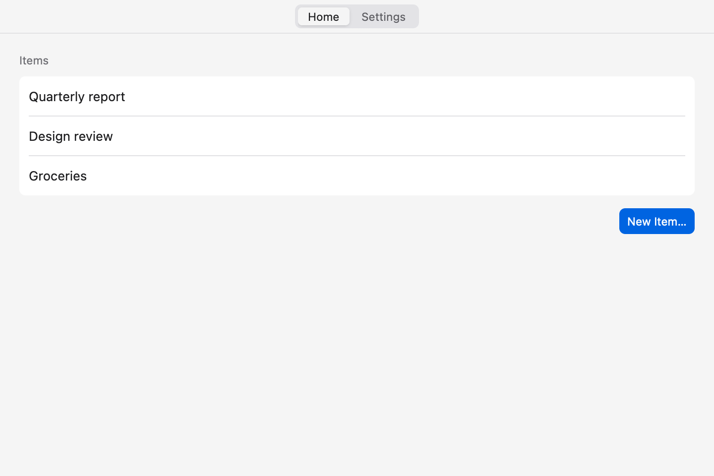
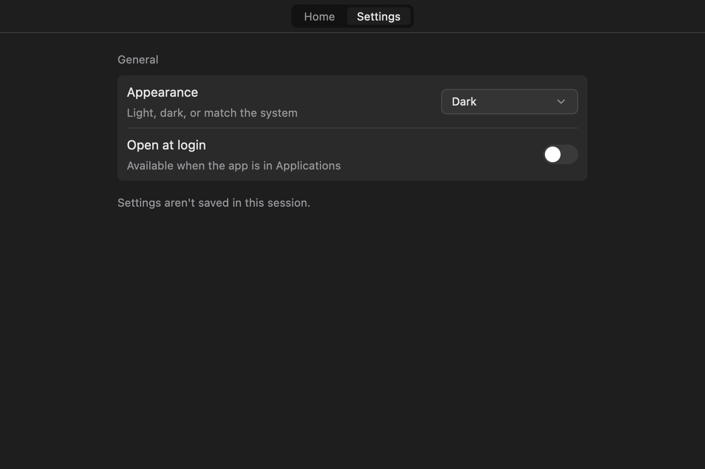
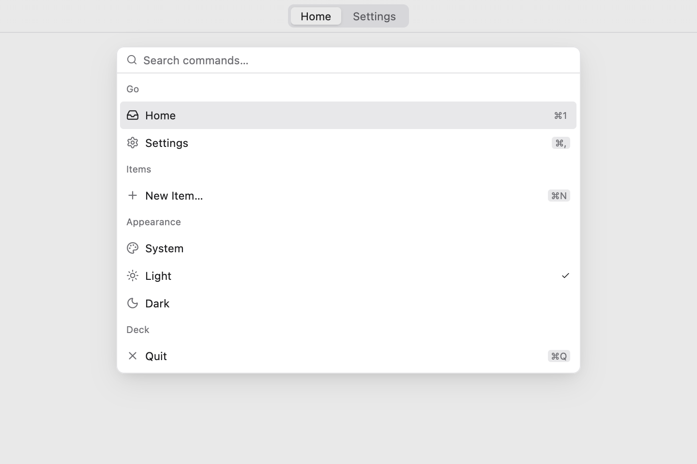

<div align="center">

# Deck

**A native desktop-app starter for macOS + Linux, built on [GPUI](https://www.gpui.rs/) via [GPUI Kit](https://github.com/longbridge/gpui-kit).**

[](https://github.com/hellno/deck/actions/workflows/ci.yml)
[](LICENSE)

Generate it, name it, ship it. You get a window that looks like a macOS app (13 px system
type, AppKit greys, one accent), the system menu bar, shortcuts, a ⌘K command palette,
persisted settings, an optional menu-bar mode, `.app` bundling, and a headless screenshot
command for agents.



</div>

---

## Quick start

Deck is a [cargo-generate](https://github.com/cargo-generate/cargo-generate) template:

```bash
cargo install cargo-generate
cargo generate gh:hellno/deck --name catchy-tv -d app_name="Catchy TV"
cd catchy-tv && cargo run
```

`--name` becomes the crate and binary name; `app_name` is the name people see, kept exactly
as typed (leave it out to get "Catchy Tv" from the crate name). You're also asked for a
bundle-id organization (`-d bundle_org=acme`).

Coding agent in a sandboxed shell? `cargo generate --init` fails there. Generate into a
temporary directory and copy the project where it belongs.

Cloning this repo and running `cargo run` won't work: the source carries `{{ }}` tokens.

Requirements: **rustup** (Rust 1.100 is pinned in `rust-toolchain.toml` and installed on
first build) and optionally [`just`](https://github.com/casey/just) for the recipes (plain
`cargo` underneath). The first build compiles GPUI and takes a few minutes.

- **macOS 11+**: Xcode Command Line Tools (`xcode-select --install`). Renders with Metal.
- **Linux**: a Vulkan GPU and these libraries (X11 and Wayland both work):

  ```bash
  sudo apt install build-essential pkg-config libxcb1-dev libxkbcommon-dev \
    libxkbcommon-x11-dev libwayland-dev libvulkan-dev libfontconfig1-dev \
    libfreetype6-dev libssl-dev   # + libgtk-3-dev libayatana-appindicator3-dev libxdo-dev for --features tray
  ```

## What you get

| | Where |
|---|---|
| Window with a custom title bar and segmented page tabs; traffic lights on macOS | `lib.rs`, `shell.rs` |
| A macOS look: 13 px type scale, neutral greys for light and dark, one accent, contrast-tested | `theme.rs` |
| Pages built from gpui-component: `Empty`, `GroupBox` rows, `Select`, `Switch`, `Alert`, `Dialog` + `Form` | `home.rs`, `settings_view.rs`, `ui.rs` |
| Settings as JSON in the OS config dir; an unreadable file is moved aside, never overwritten | `settings.rs` |
| Shortcuts → actions → native menu bar, with a test that parses every shortcut for macOS and Linux | `lib.rs` |
| ⌘K command palette (gpui-component `Command`) running the same actions, with their shortcuts shown | `palette.rs` |
| `just shot`: headless PNG of a real page, no window, no focus change | `examples/shot.rs` |
| Dry-run mode and `APP_*` env hooks to start the app in a given state | `launch.rs` |
| Optional menu-bar / tray mode (`--features tray`) | `tray.rs` |
| Open at login (macOS LaunchAgent), `just bundle` / `just install` | `login_item.rs`, `justfile` |
| App icon pipeline (image → squircle → `.icns`) | `scripts/`, `assets/` |

How and why: [docs/LEARNINGS.md](docs/LEARNINGS.md). Agent rules: `AGENTS.md` in the
generated project.




## Seeing the UI (for you and your agents)

```bash
just shot settings dark /tmp/settings.png     # headless, real renderer, 2x, deterministic
APP_FIXTURES=1 just shot home light /tmp/home.png
just dry-run                                   # the real app: separate settings file, no focus stealing
```

`just shot` renders the app's real views offscreen (Metal + CoreText on macOS): no window,
no Dock icon, byte-identical output across runs. It shows the view only (no traffic lights),
and needs the GPU, so it fails inside agent sandboxes like Seatbelt. Env hooks such as
`APP_PAGE=settings` and `APP_APPEARANCE=dark` put the live app in a state without clicks;
add your own in `src/launch.rs`.

## Menu-bar / tray mode

```bash
cargo run --features tray
```

A native status item with Show / Quit, and no Dock icon on macOS. Menu events arrive
through a channel (no polling), the app keeps running with its window closed, and "Show"
reopens it.

## Shipping

```bash
cargo install cargo-bundle
just bundle      # target/release/bundle/osx/<App>.app
just install     # ad-hoc sign, quit the running copy, replace it in /Applications
```

macOS notifications need the app launched from a bundle; "Open at login" needs the copy in
`/Applications`. On Linux:
`cargo bundle --release --format deb`.

## Upgrading GPUI

In a generated app: bump `gpui-kit` in `Cargo.toml` (and `rust-version` +
`rust-toolchain.toml` if it needs a newer Rust), `cargo update -p gpui-kit`, `just ci`, then
launch the app: some breakage only shows at runtime. In this template, `just update-lock -p
gpui-kit` does the same in a rendered project (see [AGENTS.md](AGENTS.md)).

## Platforms

| | macOS | Linux |
|---|---|---|
| App | ✅ daily-driven | ✅ builds and tests in CI |
| Renderer | Metal | Vulkan (wgpu), X11 + Wayland |
| Bundle | `.app` + `.icns` | `.deb` |
| Tray | ✅ | builds; runs on its own GTK thread (not yet run on Linux by the author) |
| Open at login | ✅ | not included |

## Keyboard shortcuts

| Shortcut | Action |
|---|---|
| `⌘K` | Command palette |
| `⌘N` | New item |
| `⌘1` | Home |
| `⌘,` | Settings |
| `⌘W` | Close window |
| `⌘Q` | Quit |

`⌘` on macOS, `Ctrl` on Linux. Add one to `shortcuts()` in `src/lib.rs`.

## Maintaining the template

`just check-template` renders a project and runs its `just ci`; `just shot` screenshots it.
See [AGENTS.md](AGENTS.md).

## Credits & license

Built on [GPUI](https://github.com/zed-industries/zed) (Zed Industries) and
[GPUI Kit](https://github.com/longbridge/gpui-kit) (Longbridge); icons are
[Lucide](https://lucide.dev) (ISC). Deck is 0BSD: no attribution required. Third-party
notices are in [NOTICE](NOTICE). `cargo-deny` checks every dependency against an explicit
license allow list in CI.
